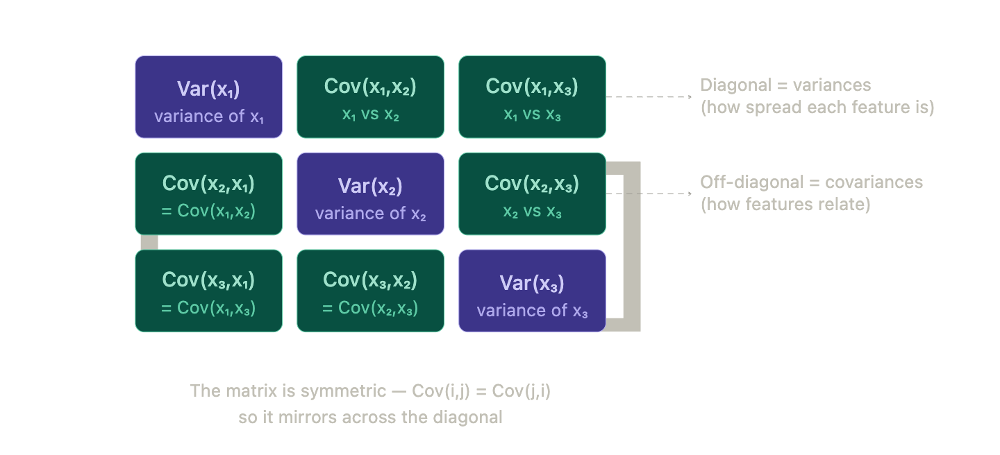
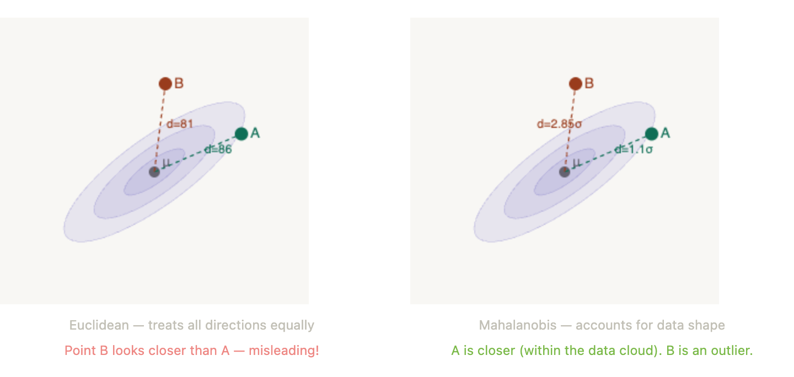

## intuition

- variance describes the spread of one feature; covariance describes how two features vary together.
- positive covariance means they tend to increase together; negative covariance means one tends to decrease as the other increases.
- zero covariance means no linear co-variation, not necessarily independence.
- a covariance matrix collects these values for every pair of features.

{.covariance-diagram fig-alt="three-by-three symmetric covariance matrix with variances on the diagonal and covariances elsewhere"}

## building the matrix

- let $x$ contain $n$ observations and $p$ features, with shape $n\times p$.
- centre each column by subtracting its mean to obtain $x_c$.
- the sample covariance matrix is $s=\frac{1}{n-1}x_c^\top x_c$ for $n>1$; its shape is $p\times p$.
- dividing by $n$ instead gives the empirical second central moment, rather than the usual unbiased sample estimator.
- each entry is $s_{jk}=\frac{1}{n-1}\sum_{i=1}^{n}(x_{ij}-\bar{x}_j)(x_{ik}-\bar{x}_k)$.

## key properties

- symmetric: $s_{jk}=s_{kj}$.
- diagonal: $s_{jj}$ is the variance of feature $j$.
- positive semidefinite: $v^\top s v\geq0$ for any vector $v$.
- scale-dependent: changing measurement units changes covariance. correlation standardises it: $\rho_{jk}=s_{jk}/\sqrt{s_{jj}s_{kk}}$ when both variances are positive.
- $x^\top x$ is a matrix of column inner products, not automatically a covariance or correlation matrix; centring and normalisation matter.

## geometry & mahalanobis distance

- for a multivariate gaussian, covariance determines the spread and orientation of its density contours.
- zero cross-covariance gives axis-aligned contours; circular contours additionally require equal variances.
- mahalanobis distance accounts for feature scales and correlations: $d^2(x,\mu)=(x-\mu)^\top s^{-1}(x-\mu)$ when $s$ is invertible.
- differences along high-variance directions receive less weight than equally sized differences along low-variance directions.

{.covariance-diagram fig-alt="two points compared using euclidean and mahalanobis distance relative to an elliptical data cloud"}

- $s^{-1}$ is the precision matrix used in the distance formula. whitening centred data uses $s^{-1/2}$, or an equivalent factor, so that the transformed covariance is the identity.
- the inverse may not exist when features are redundant or samples are limited; regularisation or a pseudoinverse may be needed.

## the normal-equation connection

- least squares minimises $\lVert x\beta-y\rVert^2$. setting its gradient to zero gives $x^\top x\beta=x^\top y$.
- if $x$ has full column rank, the solution is $\hat\beta=(x^\top x)^{-1}x^\top y$.
- for centred features, $x_c^\top x_c=(n-1)s$: the normal equations and covariance share the same inner-product structure.
- include an intercept or centre the predictors and target consistently. in practice, use a stable least-squares solver rather than explicitly inverting $x^\top x$.
- [gradient descent](../training-evaluation/gradient-descent.qmd) reaches a least-squares solution through iterative updates instead.

## where it appears

- pca: eigenvectors give principal directions; eigenvalues give their variances.
- multivariate gaussians: the mean and covariance specify the distribution.
- lda: within-class and between-class scatter guide class separation.
- factor analysis: covariance is explained through shared factors and feature-specific noise.
- kalman filters: covariance tracks uncertainty as predictions and measurements are combined.

## image credit

- the covariance diagrams were made using claude.

## references

- [numpy: covariance estimation](https://numpy.org/doc/stable/reference/generated/numpy.cov.html).
- [numpy: least-squares solutions](https://numpy.org/doc/stable/reference/generated/numpy.linalg.lstsq.html).
- [scikit-learn: pca and whitening](https://scikit-learn.org/stable/modules/generated/sklearn.decomposition.PCA.html).
