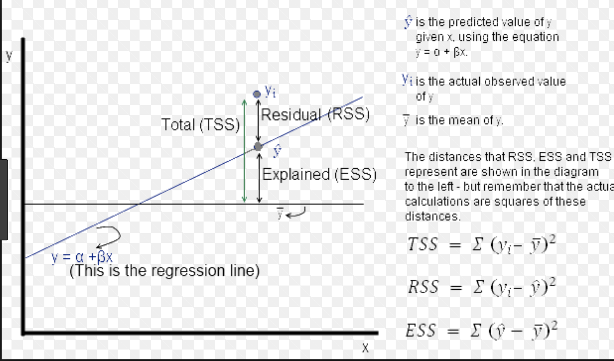

## intuition

- linear regression models the outcome as a linear combination of the features: $\hat y=\beta_0+\beta_1x_1+\dots+\beta_px_p=x\beta$
- ordinary least squares (ols) chooses $\beta$ to minimise the sum of squared residuals, $\sum_i(y_i-\hat y_i)^2$
- ols implicitly models the conditional distribution $P(y\mid x)$ as gaussian, with $x$ affecting only the mean and the variance staying constant across $x$ — if that gaussian-noise assumption holds, ols is also the maximum-likelihood estimator, see [loss functions](../training-evaluation/loss-functions.qmd#the-key-connection)

## ols as projection

- a projection $p$ is a linear map with $p^2=p$ — applying it twice does nothing more than applying it once
- geometrically, predictions $\hat y$ are the orthogonal projection of $y$ onto the column space of $x$: the subspace spanned by every possible linear combination of the feature columns
- $\hat y$ is the point in that subspace closest to $y$ in euclidean distance, and the closest point always lands perpendicular to the subspace — so the residual $e=y-\hat y$ is orthogonal to every column of $x$: $x^\top(y-x\beta)=0$, the normal equation
- orthogonal residuals mean the leftover error has zero correlation with every feature — there's no linear combination of the features left that would get you any closer to $y$
- this is the same inner-product structure as the [covariance matrix](../foundations/covariance-matrix.qmd#the-normal-equation-connection): for centred features, $x_c^\top x_c=(n-1)s$

## assumptions

- linearity: the relationship between features and the conditional mean of $y$ is linear
- independence of observations and of errors across observations
- homoscedasticity: error variance is constant across the range of $x$
- no perfect multicollinearity: no feature is an exact linear combination of the others, or $x^\top x$ isn't invertible
- errors have mean zero
- violating these doesn't make predictions meaningless, but it invalidates the usual standard errors, confidence intervals, and significance tests built on top of ols

## fitting the model

- **normal equation** (closed form): if $x$ has full column rank, $\hat\beta=(x^\top x)^{-1}x^\top y$ solves the normal equation directly — no iteration needed, see [covariance matrix](../foundations/covariance-matrix.qmd#the-normal-equation-connection)
- **gradient descent** (iterative): starting from an initial guess, repeatedly step opposite the gradient of the loss until convergence — see [gradient descent](../training-evaluation/gradient-descent.qmd) for the full derivation and update rule
- for ordinary least squares the loss surface is convex — a bowl shape in parameter space — so gradient descent reliably converges to the global minimum, tracing a path like the one below

{fig-alt="contour plot showing gradient descent's optimization path spiraling into the minimum of a convex loss surface in two-parameter space" width=560}

- both methods find the same optimum for ols; the normal equation is exact but costly to invert for very many features, while gradient descent scales better and is the only practical option once the loss isn't convex (e.g. with certain regularisers or nonlinear models)

## evaluating the fit: tss, rss & r²

- **total sum of squares (tss)**: $\text{tss}=\sum_i(y_i-\bar y)^2$ — how spread out the outcome is around its mean, before any model
- **residual sum of squares (rss)**: $\text{rss}=\sum_i(y_i-\hat y_i)^2$ — the error left after fitting the model
- **explained sum of squares (ess)**: $\text{ess}=\sum_i(\hat y_i-\bar y)^2$ — the variation the model accounts for
- these decompose cleanly: $\text{tss}=\text{ess}+\text{rss}$, and $r^2=1-\dfrac{\text{rss}}{\text{tss}}=\dfrac{\text{ess}}{\text{tss}}$

{fig-alt="scatter plot with a regression line and a mean line, showing how the vertical distance from a point to each line relates to tss, rss, and ess" width=560}

- a small rss relative to tss means the model explains most of the variation in $y$; a large rss means it doesn't — this is exactly what $r^2$ summarises in one number, see [evaluation metrics](../training-evaluation/evaluation-metrics.qmd#regression-metrics-for-comparison) for mae/mse/rmse/$r^2$ formulas and when to use each
- adjusted $r^2$ corrects for the fact that $r^2$ never decreases when more features are added, even useless ones: $r^2_{\text{adj}}=1-(1-r^2)\dfrac{n-1}{n-p-1}$, with $p$ features and $n$ observations — useful when comparing models with different numbers of features

## practical considerations

- check residual plots (residuals vs. fitted values, vs. each feature) for non-linearity, heteroscedasticity, and outliers rather than relying on $r^2$ alone — see [residuals, leverage & influence](../training-evaluation/bias-variance.qmd#residuals-leverage-influence)
- near-collinear features make $(x^\top x)^{-1}$ ill-conditioned, inflating coefficient variance even when predictions remain fine — [regularisation](../training-evaluation/regularisation.qmd) (ridge in particular) is a standard fix
- standardise features before regularised or gradient-based fitting; it doesn't change ols coefficients' predictions but does change their relative scale and is required for the penalty terms in ridge/lasso to be meaningful, see [feature engineering](../training-evaluation/feature-engineering.qmd#scaling-transformations)
- $r^2$ (and adjusted $r^2$) describe fit on the data they're computed on — always evaluate on held-out data, see [train/test splits](../training-evaluation/train-test.qmd)

## image credit

- the gradient descent trajectory and tss/rss/ess diagrams are from the author's own ml course notes; no public source link is available for either

## references

- [statsmodels: ordinary least squares](https://www.statsmodels.org/stable/regression.html)
- [scikit-learn: linear models](https://scikit-learn.org/stable/modules/linear_model.html#ordinary-least-squares)
