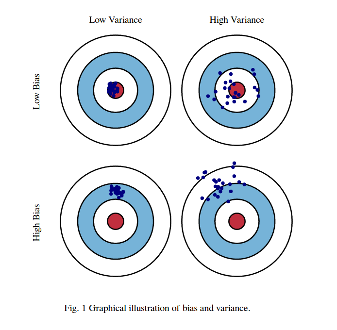

## residuals, leverage & influence

- a residual is observed minus predicted: $e_i=y_i-\hat y_i$. in a regression plot, it is the vertical prediction error.
- leverage measures how unusual an observation’s predictors are relative to the training design; it is the diagonal entry $h_{ii}$ of the hat matrix.
- high leverage gives a point the potential to affect the fit, but does not guarantee strong influence.
- cook’s distance summarises how much the fitted model changes when an observation is omitted; it combines residual size and leverage.

::: {.table-responsive tabindex="0"}

| diagnostic | main question | what to inspect |
|---|---|---|
| residual | is the observed outcome unusual given its predictors? | large standardised residuals; patterns against fitted values |
| leverage | is the point unusual in predictor space? | unusually large $h_{ii}$ |
| cook’s distance | does removing the point substantially change the fit? | large influence relative to other observations |

:::

- for ordinary least squares, $d_i=\frac{e_i^2}{p\hat\sigma^2}\frac{h_{ii}}{(1-h_{ii})^2}$, with $p$ fitted parameters including the intercept and $\hat\sigma^2$ the residual mean square.
- common screening rules are $h_{ii}>2p/n$, absolute standardised residuals above 2, and $d_i>4/n$.
- these are investigation flags, not automatic deletion rules. check data quality, context, and sensitivity of the conclusions.

## bias, variance & noise

- assume $y=f(x)+\epsilon$, with zero-mean noise conditional on $x$.
- bias is the difference between the average prediction across training datasets and the true function: $\operatorname{bias}(x)=\mathbb{E}[\hat f(x)]-f(x)$.
- variance measures how predictions change when the model is retrained on different samples: $\operatorname{var}(\hat f(x))=\mathbb{E}[(\hat f(x)-\mathbb{E}[\hat f(x)])^2]$.
- irreducible noise is outcome variation the available predictors cannot explain.
- at a fixed input, expected squared prediction error decomposes into $\operatorname{bias}(x)^2+\operatorname{var}(\hat f(x))+\operatorname{var}(\epsilon\mid x)$, averaging over training samples and new outcome noise.

{fig-alt="four target diagrams contrasting low and high bias with low and high variance" width=560}

## recognising underfitting & overfitting

::: {.table-responsive tabindex="0"}

| pattern | training error | validation error | possible response |
|---|---|---|---|
| underfitting / high bias | relatively high | relatively high | improve features or try a more flexible model |
| overfitting / high variance | low | substantially higher | regularise, simplify, or collect more representative data |
| good generalisation | suitably low | similar and suitably low | confirm on an untouched test set |

:::

- these patterns are clues, not proof; leakage, distribution shift, and noisy labels can produce similar symptoms.
- increasing model flexibility often reduces bias while increasing variance, but the relationship is not universal.
- [regularisation](regularisation.qmd), averaging models, and cross-validation can help manage prediction error; keep the final test set separate from tuning.

## references

- [statsmodels: regression influence diagnostics](https://www.statsmodels.org/stable/generated/statsmodels.stats.outliers_influence.OLSInfluence.html).
- [scikit-learn: bias–variance decomposition](https://scikit-learn.org/stable/auto_examples/ensemble/plot_bias_variance.html).
