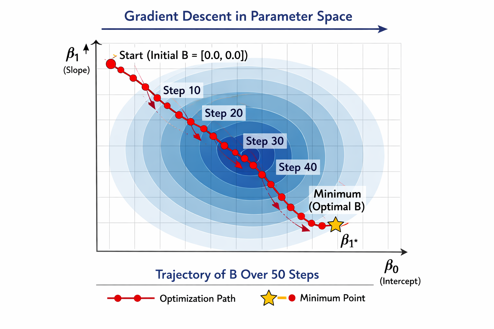

## intuition

- gradient descent updates model parameters to reduce a loss function
- the gradient points towards the steepest local increase; move in the opposite direction
- the learning rate $\alpha$ controls the step size: $\beta_{t+1}=\beta_t-\alpha\nabla_\beta l(\beta_t)$

{fig-alt="contour plot showing gradient descent's optimization path spiraling into the minimum of a convex loss surface in two-parameter space" width=560}

## deriving the least-squares gradient

- let $x$ have shape $(n,p)$, $\beta$ have shape $(p,)$, and $y$ have shape $(n,)$
- predictions are $x\beta$; residuals are $r=x\beta-y$
- define the loss as half the mean squared error: $l(\beta)=\frac{1}{2n}\lVert x\beta-y\rVert^2$
- differentiating the squared residuals gives $\nabla_\beta l=\frac{1}{n}x^\top(x\beta-y)$, one gradient value per parameter
- using $1/n$ instead of $1/(2n)$ in the loss produces a factor of two in the gradient. either convention works when the learning rate is adjusted consistently

## one update in python

- compute predictions, residuals, and the gradient, then update the parameters

```python
predictions = x @ beta
residuals = predictions - y
gradient = x.transpose() @ residuals / len(y)
beta = beta - learning_rate * gradient
```

- the gradient has shape $(p,)$, matching `beta`
- in the original notes, `residuals.dot(x)` gives the same result as `x.transpose() @ residuals` when residuals are a one-dimensional array
- include a column of ones in `x` to learn an intercept, or update the intercept separately

## repeating the update

- initialise parameters, choose a learning rate, and repeat the update until a stopping criterion is met
- track loss and stop when improvement becomes small or a maximum iteration count is reached
- a learning rate that is too large can cause oscillation or divergence; one that is too small makes progress slow
- scaling features can improve convergence; fit the scaler using training data only

## batch, stochastic & mini-batch

- batch gradient descent uses every training sample for each update
- stochastic gradient descent uses one sample per update; steps are noisier
- mini-batch gradient descent uses a small group of samples, balancing efficiency and noise

## connections

- unregularised least squares is convex: a suitable learning rate can converge to a global minimum, although parameters need not be unique
- a direct least-squares solver is an alternative; see the [normal-equation connection](../foundations/covariance-matrix.qmd#the-normal-equation-connection)

## image credit

- the gradient descent trajectory diagram is from the author's own ml course notes; no public source link is available

## references

- [scikit-learn: stochastic gradient descent](https://scikit-learn.org/stable/modules/sgd.html)
- [numpy: least-squares solutions](https://numpy.org/doc/stable/reference/generated/numpy.linalg.lstsq.html)
